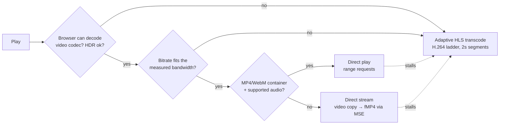

# Streamarr

A self-hosted, Plex-style streaming server for your own movies and shows — built around one goal: **playback that doesn't stop to buffer** on a decent connection.

Node.js + FFmpeg on the server, a React web app with a custom player, one Docker container.

---

## Why it doesn't buffer like Plex

Most "buffering…" on a good connection isn't the network — it's the server's transcoder falling behind, a client buffer that's too shallow, or the server picking one fixed quality and hoping for the best. Streamarr attacks each of those:

| Problem | What Streamarr does |
|---|---|
| Transcoding when it isn't needed | A per-device decision engine prefers **Direct play** (original file, zero CPU) → **Direct stream** (video copied bit-for-bit, only the container/audio converted) → **Adaptive transcode**, in that order. Codec support is probed in the browser, not guessed from a device profile. |
| Shallow buffers | Direct stream is fed through Media Source Extensions by the player, which keeps **~150 s buffered ahead** (a plain `<video>` on a progressive stream only buffers 2–3 s in Chrome). HLS playback keeps 90 s (up to 10 min) ahead. |
| Transcoder throttled too early | The encoder runs **4 minutes ahead** of the furthest segment requested before it's paused (`SIGSTOP`, instant resume). Plex keeps roughly a minute. Configurable. |
| One fixed transcode quality | Transcodes are a real **adaptive-bitrate ladder** (2160p → 360p). The player steps down instead of stalling. Only the rendition actually being watched is encoded. |
| Slow seeking | Converted streams use a fixed 2-second keyframe grid, so a seek **restarts the encoder exactly at the target segment** (~1.2 s for 1080p H.264 on a modest CPU). Direct stream seeks cancel the obsolete download instantly and restart at the nearest keyframe (0.2–1 s). |
| Original file too heavy for the link | Playback **starts immediately** with the remembered connection speed (first visit: a ≤1.2 s check); the full speed test only runs while you browse. The player then measures the real stream in its first ~1.5 s and switches to adaptive quality *before* the buffer runs dry if the connection can't carry the original. |
| Buffering anyway | A **stall watchdog** that tells causes apart: a stall with an empty buffer (network) switches to adaptive streaming; a stall with data buffered (stuck decoder) gets a fresh restart at the same spot first. Decoder errors on a damaged section: restart → skip to the next keyframe → convert just that part and return to the original. |
| Server can't keep up | The server **learns how fast it converts** each kind of source to each quality and only offers qualities it sustains at ≥1.3× real time. While playing, a conversion running under ~1.05× with < 20 s buffered steps down before the viewer sees a stall. CPU-only servers are never offered renditions above `MAX_SOFTWARE_HEIGHT` (default 1080p). |
| Lip sync drifting after a seek | Direct stream keeps every track's **original timestamps** instead of restarting the clock per track, so picture and sound stay within a frame after seeks and resumes (checked in CI on a B-frame H.264 clip). |
| GPU path breaks | VAAPI/NVENC jobs that fail fall back to hybrid (CPU decode/filters + GPU encode) and then pure CPU, automatically and invisibly. |
| Background jobs fighting the stream | Thumbnail and subtitle extraction freeze whenever a player is open (any mode) and run in the idle disk-priority class. |



**Snappy like a streaming service:** the player code loads while you browse (hls.js only when a stream is converted), the stream request starts in parallel with the player's media buffer, pages render instantly from cache on Back and on cards you hovered, artwork is served at the size it is displayed, and app code and API responses are compressed (Brotli).

The **Playback info** panel in the player (press `i`) shows the mode, why it was chosen, buffer depth, connection estimate, dropped frames and live encoder speed.

## Features

- **Libraries** for movies, TV shows (show → season → episode) and other videos; scene-style filenames are parsed (`The.Matrix.1999.1080p.BluRay.x264.mkv`, `Show.S01E02.mkv`, `1x02`, `Season 1/Episode 3`). Incremental rescans, periodic rescans, folder picker.
- **Metadata from TMDB** (optional, free key): posters, backdrops, title logos, cast, ratings, genres, episode stills. Local artwork (`poster.jpg`, `fanart.jpg`, `Movie-poster.jpg`, `season01-poster.jpg`, `Episode-thumb.jpg`) always wins. Fix wrong matches by TMDB id. Without TMDB, titles get generated typographic posters and frame-grab backdrops.
- **Home**: rotating hero, Continue watching, Up next (next unwatched episode), My list, recently added per library, highly rated, genre rows.
- **Player**: custom controls, seek-bar **preview thumbnails**, chapter markers, subtitle rendering with size options, audio/subtitle switching mid-stream, quality menu (Auto / Original / fixed rungs), playback speed, picture-in-picture, fullscreen, keyboard shortcuts, media keys & lock-screen controls, screen wake lock, **auto-play next episode** (credits-chapter aware).
- **Subtitles**: embedded text tracks and sidecar `.srt/.vtt/.ass` (`Movie.en.srt`, `Movie.hu.forced.srt`) converted to WebVTT and pre-extracted in the background; picture-based subtitles (PGS/VobSub) are burned in on demand. Per-user default languages and "forced only" mode.
- **HDR → SDR tone mapping** (Hable) for HDR10/HLG/Dolby Vision on SDR screens; HDR screens get the original.
- **Hardware transcoding**: Intel Quick Sync / AMD via VAAPI, NVIDIA via NVENC, with automatic fallback.
- **Multi-user**: per-user watch progress, watched state, My list, playback preferences; admin and viewer roles.
- **Server dashboard**: live sessions (mode, reasons, encoder speed, throttle state, client buffer, stalls, stop button), play history, direct-play ratio, hardware detection, encoder self-test, library management, user management, settings.
- Search across titles, episodes and cast. Mobile-friendly, installable as a PWA, works offline-LAN (fonts are bundled).

## Quick start (Linux + Docker)

```bash
git clone https://github.com/<you>/streamarr.git
cd streamarr
cp .env.example .env
nano .env            # set MEDIA_DIR, PUID/PGID (run `id`), optionally TMDB_API_KEY
docker compose up -d --build
```

Open `http://<server-ip>:8420`, create the admin account, then **Server dashboard → Libraries → Add library** and pick folders under `/media`.

### Folder layout

```
/srv/media                 (MEDIA_DIR on the host → /media in the container)
├── movies/
│   ├── The Matrix (1999)/The.Matrix.1999.1080p.BluRay.mkv
│   └── Blade Runner 2049 (2017).mkv
└── shows/
    └── Breaking Bad/
        ├── poster.jpg
        ├── Season 01/Breaking.Bad.S01E01.Pilot.mkv
        └── Season 02/Breaking Bad - 2x01 - Seven Thirty-Seven.mkv
```

Several drives? Mount each under `/media` in `docker-compose.yml`:

```yaml
    volumes:
      - /mnt/disk1/movies:/media/movies:ro
      - /mnt/disk2/tv:/media/shows:ro
```

### GPU transcoding

**Intel / AMD (VAAPI)**

```bash
docker compose -f docker-compose.yml -f docker-compose.vaapi.yml up -d --build
```

The GPU's device group is picked up automatically.

**NVIDIA (NVENC)** — install the [NVIDIA Container Toolkit](https://docs.nvidia.com/datacenter/cloud-native/container-toolkit/latest/install-guide.html), then:

```bash
docker compose -f docker-compose.yml -f docker-compose.nvidia.yml up -d --build
```

Check it under **Server dashboard → Settings → Test encoder**. With a GPU the 1440p/2160p rungs are enabled.

### Updating

```bash
git pull && docker compose up -d --build
```

Your database and caches live in `CONFIG_DIR` (`./data` by default) and survive rebuilds.

## Configuration

Environment variables seed the defaults; everything below is also editable live in **Server dashboard → Settings**.

| Variable | Default | Meaning |
|---|---|---|
| `MEDIA_DIR` | `/srv/media` | Host folder mounted read-only at `/media` |
| `CONFIG_DIR` | `./data` | Database, artwork cache, trickplay sheets, subtitles |
| `PUID` / `PGID` | `1000` | User the server runs as (must be able to read your media). The container takes ownership of its own data folder on start, so a root-created `./data` is fine. |
| `TMDB_API_KEY` | – | v3 key or v4 read token |
| `HWACCEL` | `none` | `none`, `vaapi`, `nvenc` |
| `TRANSCODE_PRESET` | `veryfast` | libx264 preset for CPU transcodes |
| `MAX_SOFTWARE_HEIGHT` | `1080` | Highest rung offered without a GPU |
| `TRANSCODE_AHEAD_SECONDS` | `240` | How far the encoder runs ahead before pausing |
| `TRANSCODE_TMPFS_SIZE` | `4g` | RAM for transcode segments (old segments are pruned; ~400 MB per stream max) |
| `SCAN_INTERVAL_MINUTES` | `30` | Automatic incremental rescans (0 = off) |
| `TRICKPLAY` | `true` | Generate seek-bar thumbnails in the background |

## Remote access

Put it behind a reverse proxy with HTTPS. For **nginx**, disable buffering so direct-stream data flows immediately and allow long-lived responses:

```nginx
location / {
    proxy_pass http://127.0.0.1:8420;
    proxy_set_header Host $host;
    proxy_set_header X-Forwarded-Proto $scheme;
    proxy_set_header X-Forwarded-For $proxy_add_x_forwarded_for;
    proxy_buffering off;
    proxy_request_buffering off;
    proxy_read_timeout 3600s;
    proxy_send_timeout 3600s;
}
```

Caddy works out of the box: `streamarr.example.com { reverse_proxy 127.0.0.1:8420 }`.

For remote users on limited upload, set **Bitrate limit** per device (Playback & account) — adaptive streaming then kicks in automatically above that.

## Keyboard shortcuts

| Key | Action |
|---|---|
| `Space` / `K` | Play / pause |
| `←` `→` / `J` `L` | Back / forward 10 s |
| `↑` `↓` | Volume |
| `F` | Fullscreen |
| `M` | Mute |
| `C` | Subtitles on/off |
| `I` | Playback info |
| `N` | Next episode |
| `Esc` | Back |

## Architecture

```
server/                         Node 22, Fastify, built-in node:sqlite (no native deps)
  src/scanner.js                library walk, ffprobe, filename parsing, show/season grouping
  src/metadata/tmdb.js          TMDB matching + artwork references
  src/streaming/decision.js     direct play / direct stream / transcode decision + bitrate ladder
  src/streaming/sessions.js     playback sessions, on-demand HLS segmenter, throttling, pruning, fallback
  src/streaming/encoder.js      FFmpeg argument builder (software / VAAPI / NVENC, tone mapping, burn-in)
  src/streaming/trickplay.js    seek preview sprite sheets (keyframe-only decode)
  src/streaming/subtitles.js    WebVTT conversion, single-pass extraction
web/                            React + Vite + hls.js
  src/player/engine.js          playback controller: hls.js, MSE remux feed, stall watchdog, reporting
  src/player/caps.js            codec/HDR capability probing, bandwidth measurement
  src/player/Player.jsx         player UI
```

Data lives in SQLite (`/config/streamarr.db`, WAL mode). Auth uses scrypt password hashes and signed HttpOnly cookies. Stream URLs carry an unguessable per-session id, so external players can open them too.

### Local development

```bash
cd server && npm install && MEDIA_ROOTS=/path/to/media npm run dev    # API on :8420
cd web && npm install && npm run dev                                  # UI on :5173, proxies /api
```

Requires Node ≥ 22.13 and `ffmpeg`/`ffprobe` on the PATH.

## Known limitations

- Web client only (any modern browser, including mobile and smart-TV browsers). No native TV apps or casting yet.
- Transcode output is H.264 + AAC stereo (widest compatibility). Direct play/stream keep original HEVC/AV1/VP9 and surround audio where the browser supports them.
- Dolby Vision profile 5 (no HDR10 base layer) tone-maps with slightly off colours.
- Safari on iPhone older than iOS 17.1 has no MSE, so it uses adaptive HLS instead of direct stream.
